# Architecture

This document describes how AI Workspace is structured and why. Decisions are recorded as ADRs in [adr/](adr/README.md);
day-to-day rules for contributors are in [AGENTS.md](../AGENTS.md). Diagrams use Mermaid and render on GitHub and in
most IDEs.

Contents:
[Goals](#1-goals-and-constraints) ·
[Context](#2-system-context) ·
[Containers](#3-containers) ·
[Backend layers](#4-backend-layers-ports-and-adapters) ·
[Provider abstraction](#5-llm-provider-abstraction) ·
[Runtime flows](#6-runtime-flows) ·
[Context management](#7-context-management) ·
[Data model](#data-model) ·
[Deployment](#9-deployment) ·
[Cross-cutting concerns](#10-cross-cutting-concerns) ·
[Extension points](#11-extension-points) ·
[Limitations](#12-known-limitations-and-scaling-notes)

## 1. Goals and constraints

| Goal | How it is achieved |
|------|--------------------|
| Switch between cloud and local models at any time, even inside one conversation | Provider and model are chosen per request; every assistant message stores the provider/model that produced it |
| Add vendors without touching business logic | Hexagonal architecture; `LlmProvider` port; adapters created by `LlmProviderFactory` beans from configuration |
| Do not assume a specific local inference engine | One OpenAI-compatible adapter; engine quirks (Ollama, vLLM, llama.cpp, SGLang, LM Studio, LocalAI) are configuration |
| Responsive UX | Server-Sent Events from the model server through the backend to the browser, without buffering; stop at any time |
| Keep working when a local model is down | Health monitoring, circuit breakers, graceful errors with one-click alternatives |
| Keep secrets on the server | All LLM calls go through the backend; keys are never serialized or logged |
| Operable | Actuator health, Prometheus metrics, structured logs with correlation ids, an admin usage dashboard |
| Runs on a laptop | One `docker compose` stack; model servers are optional and pluggable |

## 2. System context

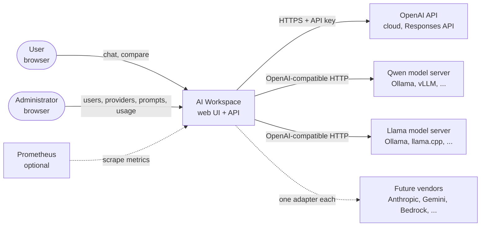

## 3. Containers

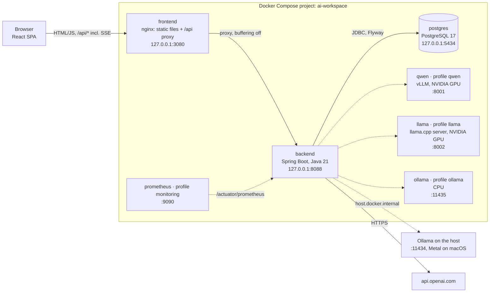

Dashed connections are optional. The backend starts and serves requests when none of the model servers are reachable;
those providers are reported as offline. The browser talks only to nginx (same origin), so no CORS is needed in
Docker. In dev mode, Vite proxies `/api` the same way.

## 4. Backend layers (ports and adapters)

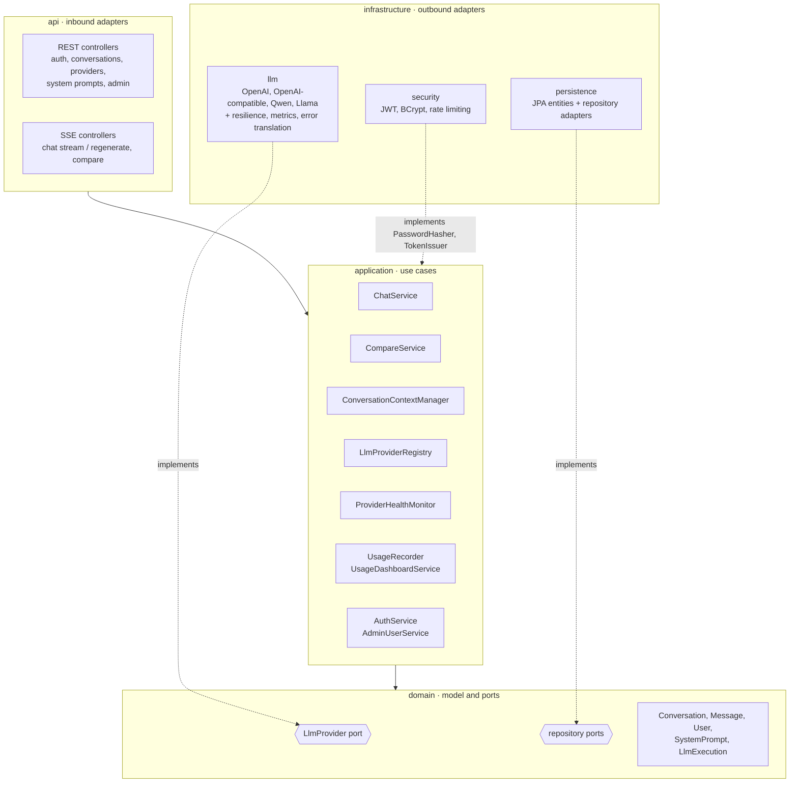

| Layer | May depend on | Contains |
|-------|---------------|----------|
| `domain` | JDK, Reactor (`Mono`/`Flux`) | Entities, value objects, the `LlmProvider` port, repository ports, the `LlmException` hierarchy |
| `application` | `domain` | Use cases, context management, provider registry and health, usage accounting, outbound ports such as `CostEstimator`, `PasswordHasher` and `TokenIssuer` |
| `api` | `application`, `domain` | Controllers, DTO records, SSE mapping, RFC 9457 error handling |
| `infrastructure` | `application`, `domain` | LLM adapters, JPA, security, configuration binding |

The application layer uses Spring stereotypes (`@Service`) for wiring, but no web, persistence or vendor types.
See [ADR 0001](adr/0001-hexagonal-architecture.md).

## 5. LLM provider abstraction

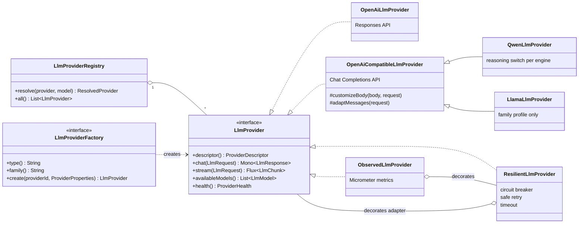

- **Neutral types** (`domain/llm`): `LlmRequest` (model, messages, `GenerationOptions`), `LlmMessage`, `LlmResponse`,
  `LlmChunk` (sealed: `TextDelta`, `ReasoningDelta`, `Completed` with `LlmUsage` and `FinishReason`), `LlmModel`,
  `ProviderDescriptor`, `ProviderHealth`, `LlmCapability`.
- **Wiring**: every entry under `llm.providers.<id>` is turned into an adapter by the factory matching `type`
  (`openai`, `openai-compatible`, ...) and optional `family` (`qwen`, `llama`). The adapter is then decorated with
  resilience and metrics and registered. No code switches on provider ids. See [ADR 0002](adr/0002-provider-port-registry-and-factories.md).
- **Local engines**: one Chat Completions adapter serves Ollama, vLLM, SGLang, llama.cpp, LM Studio and LocalAI. The
  `engine` setting only selects quirks, such as how Qwen 3 thinking is switched off. See [ADR 0003](adr/0003-openai-compatible-adapter-for-local-models.md).
- **Resolution**: `resolve(provider, model)` falls back to the default provider and to the provider's effective
  default model (configuration, overridden by the admin settings). It fails with a clear error for unknown or
  disabled providers.

## 6. Runtime flows

### 6.1 Streaming a chat message

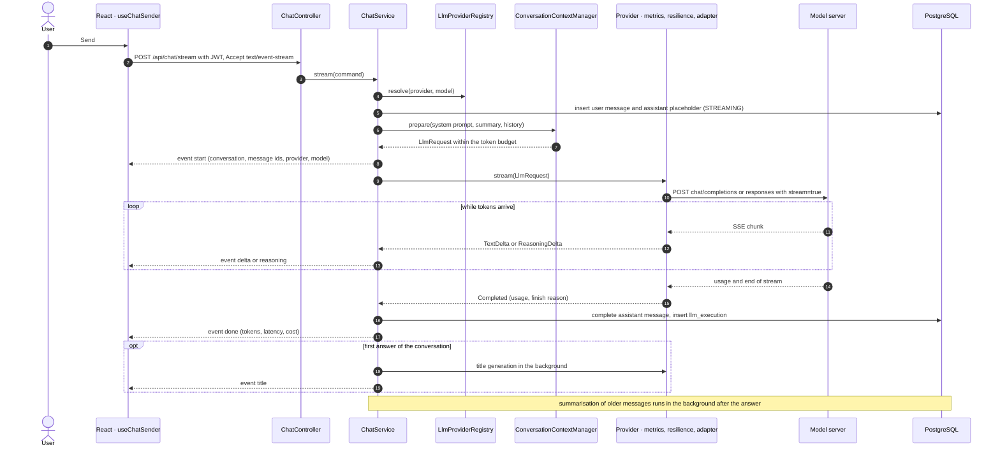

The SSE response is a `Flux<ServerSentEvent>` returned from a Spring MVC controller running on virtual threads.
Heartbeat comments every 15 s keep proxies from closing idle streams. nginx runs with `proxy_buffering off`, and the
backend sends `X-Accel-Buffering: no`. See [ADR 0004](adr/0004-server-sent-events-for-streaming.md) and
[ADR 0005](adr/0005-servlet-stack-with-virtual-threads.md).

### 6.2 Provider unavailable and switching providers

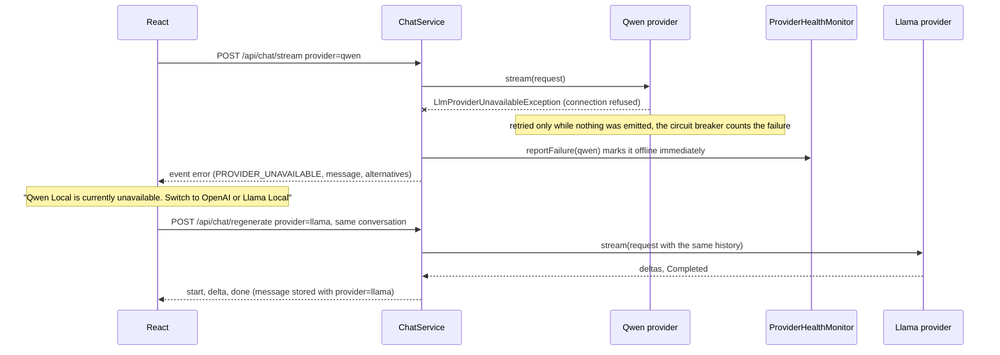

Vendor errors are translated into neutral exceptions (`LlmErrorCode`: `PROVIDER_UNAVAILABLE`,
`AUTHENTICATION_FAILED`, `RATE_LIMITED`, `TIMEOUT`, `INVALID_REQUEST`, `MODEL_NOT_FOUND`, `CONTENT_FILTERED`,
`UPSTREAM_ERROR`, `STREAM_INTERRUPTED`). Before a stream starts they become problem details; once streaming, they
become an `error` event. The conversation is never lost: the failed answer is stored with status `ERROR`.

### 6.3 Stopping a generation

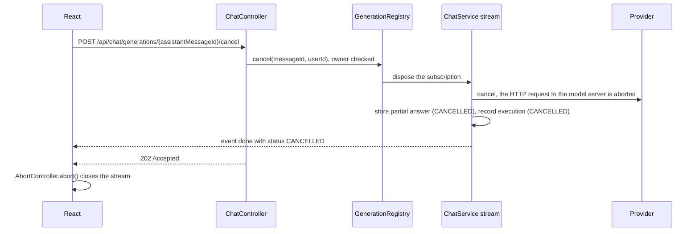

Closing the connection alone (tab closed, network lost) has the same effect: the subscription is cancelled when the
servlet container reports the disconnect.

### 6.4 Compare mode

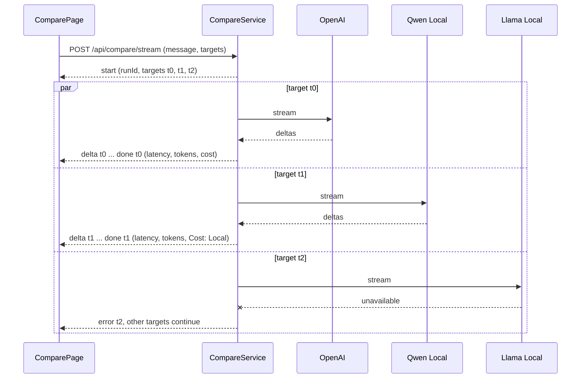

Compare runs are not stored in conversations. Each call is recorded in `llm_executions` with purpose `COMPARE`, so it
shows up in the usage dashboard. At most `chat.compare.max-targets` (default 4) targets run per request.

### 6.5 Provider health monitoring

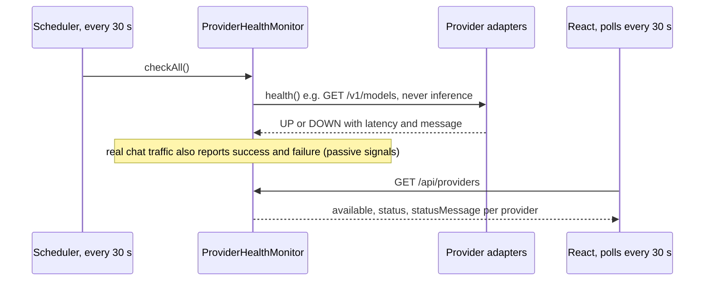

The `llm_provider_up` gauge exposes the same information to Prometheus. Administrators can force a check from
**Admin → Providers → Check now**.

### 6.6 Authentication and authorization

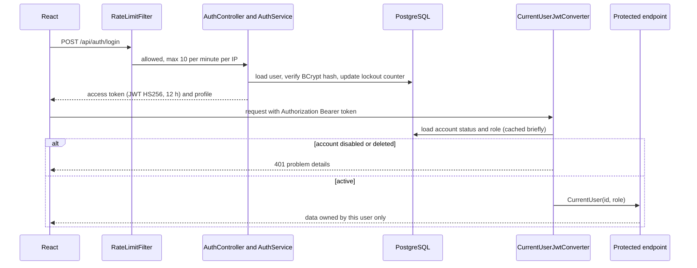

Tokens are stateless, but every request checks the live account state. Disabling or deleting a user therefore takes
effect immediately ([ADR 0008](adr/0008-stateless-jwt-with-live-account-checks.md)). Repositories always filter by the
owner, so other users' conversations return 404.

## 7. Context management

`ConversationContextManager` prepares a provider-neutral request from the conversation:

| Strategy | Behaviour |
|----------|-----------|
| `FULL_CONTEXT` | All completed messages |
| `LAST_N_MESSAGES` | The last `chat.context.last-n-messages` (20), then trimmed to the token budget |
| `TOKEN_WINDOW` | The newest messages that fit `chat.context.max-context-tokens` (8000) |
| `SUMMARY_PLUS_RECENT` (default) | Rolling summary of older messages + the newest messages that fit the budget |

- The system prompt (selected profile) and the rolling summary form one leading system message, kept separate from
  the history.
- Failed and in-flight answers are excluded. Roles are normalised to alternate, because some chat templates reject
  anything else.
- `ConversationSummarizer` runs in the background after an answer when the unsummarised history exceeds
  `summary-trigger-tokens` (6000). It folds all but the last `summary-keep-recent-messages` (6) into the summary,
  using the conversation's provider (or `chat.summary.provider`), so summarisation never delays a response.
- Token counts are estimated (`TokenEstimator`, about 3.5 characters per token). Exact usage reported by providers
  is stored per execution.

See [ADR 0006](adr/0006-summary-plus-recent-context-strategy.md).

## 8. Data model

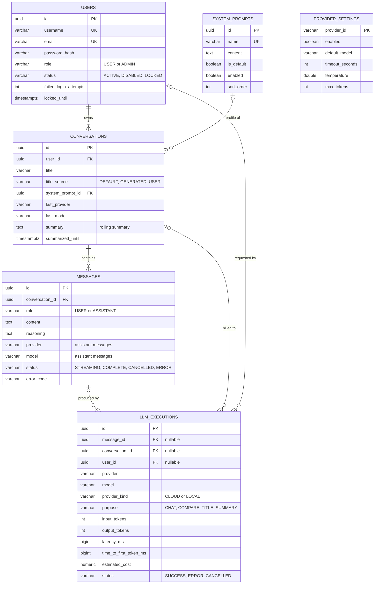

- Every assistant message records `provider` and `model`, so one conversation can mix answers from several models.
- `llm_executions` holds one row per LLM call, including titles and summaries. References use `ON DELETE SET NULL`,
  so usage statistics survive deletions.
- `provider_settings` stores administrator overrides; `NULL` means "use the configured value".
- The schema is managed by Flyway (`backend/src/main/resources/db/migration`); Hibernate only validates it.

## 9. Deployment

| Mode | Command | Components |
|------|---------|------------|
| Containers | `scripts/deploy.sh` | postgres, backend, frontend (+ optional profiles) |
| Development | `scripts/run-dev.sh start` | postgres container; backend jar and Vite dev server on the host |
| Status | `scripts/status.sh` | Checks everything above plus providers and model servers |

Local model options:

| Setup | Base URL seen by the backend container | Notes |
|-------|----------------------------------------|-------|
| Ollama on the host (recommended on macOS) | `http://host.docker.internal:11434/v1` | Uses the Apple GPU (Metal); containers on macOS cannot |
| `--profile ollama` | `http://ollama:11434/v1` | CPU-only on macOS; pulls the configured models on first start |
| `--profile qwen` | `http://qwen:8000/v1` | vLLM, NVIDIA GPU, Hugging Face model id |
| `--profile llama` | `http://llama:8000/v1` | llama.cpp `server-cuda`, NVIDIA GPU, GGUF model |
| Any other server | Any URL | LM Studio, LocalAI, SGLang, remote vLLM, ... |

Container health: postgres uses `pg_isready`, and the backend uses `/actuator/health/readiness` (it depends on the
database, not on LLM providers). All ports bind to `127.0.0.1`.

## 10. Cross-cutting concerns

**Configuration.** Precedence, from lowest to highest: `application.yml` defaults, then environment variables
(`.env` via Compose), then runtime overrides in `provider_settings` (enabled, default model, timeout, temperature,
max tokens). Overrides are reloaded every 15 s, so several backend instances converge. No URL, model, credential,
timeout or token limit is hardcoded.

**Security.**
- JWT (HS256) bearer tokens; passwords hashed with BCrypt (strength 12); lockout after 5 failed logins for 15 min.
- Roles `USER` and `ADMIN`; `/api/admin/**` and non-public actuator endpoints require `ADMIN`.
- Per-user data isolation in every repository query.
- Token-bucket rate limits: auth 10/min per IP, chat 30/min per user, compare 10/min per user. At most 3
  concurrent generations per user.
- CORS allow-list for development origins.
- API keys masked in the admin API and never logged. Prompts are not logged by default.

**Resilience** (per provider, Resilience4j; see [ADR 0007](adr/0007-retry-only-when-safe.md)):
- Circuit breaker: count-based window of 20 calls, opens at 50 % failures, half-open after 20–30 s. Only provider
  failures count, not invalid requests.
- Retry: at most 2 attempts with exponential backoff, only for retryable errors (connection refused, 502/503, short
  429 with `Retry-After` of 5 s or less), never after the first streamed chunk and never on timeouts.
- Timeout: overall for non-streaming calls; for streams it bounds the wait for each chunk (time to first token
  included).
- `StaleGenerationCleaner` finalizes answers left in `STREAMING` after a crash.

**Observability.**
- Metrics: `llm_requests_total`, `llm_request_duration_seconds`, `llm_input_tokens`, `llm_output_tokens`,
  `llm_errors_total` (tags `provider`, `model`, `status`, plus `code` on errors), `llm_provider_up` and
  `llm_active_generations`.
- `X-Correlation-Id` on every request and log line; structured ECS logs in containers.
- Actuator liveness and readiness probes; the admin usage dashboard (requests, tokens, cost, latency, error rate,
  local vs cloud).

## 11. Extension points

| Capability | Where it plugs in |
|------------|-------------------|
| New vendors: Anthropic, Gemini, Mistral, DeepSeek, Azure OpenAI, Bedrock | One adapter + factory, or configuration only for OpenAI-compatible APIs ([skill](../.github/skills/add-llm-provider/SKILL.md)) |
| Tool/function calling, MCP servers | Tool definitions on `LlmRequest`, a `ToolCall` chunk type, gating on `LlmCapability.TOOL_CALLING`, an application-level tool executor with an MCP client as an outbound adapter |
| Multimodal input, file uploads | Content parts on `LlmMessage`, `LlmCapability.VISION`, a storage port |
| RAG, web search | A retrieval port consulted by `ConversationContextManager` before the history is added |
| Speech-to-text, text-to-speech | Separate ports (`TranscriptionProvider`, `SpeechProvider`) using the same registry/factory pattern |
| Agentic workflows | An application service orchestrating several `LlmProvider` calls and tools; SSE already supports new event types |
| Accurate token budgets | A model-specific `TokenEstimator` implementation |

These are designed seams, not implemented features.

## 12. Known limitations and scaling notes

- `GenerationRegistry` (explicit cancel), the rate-limit buckets and the cached health state live in memory per
  backend instance. With several instances, route a user's requests to the same instance (sticky sessions) or move
  this state to a shared store such as Redis. Closing the SSE connection cancels on any instance.
- Each open stream holds one virtual thread and one HTTP connection to the model server. This is cheap, but local
  model servers usually process only a few requests in parallel.
- Cost estimates come from the configured price table (`llm.providers.openai.pricing`) and must be kept in sync with
  vendor pricing.
- Context budgeting uses an estimated token count; very different tokenizers can over- or under-fill the context.
- Logout is client-side (stateless JWT). Account disabling and deletion still take effect immediately.

## Architecture decision records

| ADR | Decision |
|-----|----------|
| [0001](adr/0001-hexagonal-architecture.md) | Hexagonal (ports and adapters) backend |
| [0002](adr/0002-provider-port-registry-and-factories.md) | `LlmProvider` port with registry and factories |
| [0003](adr/0003-openai-compatible-adapter-for-local-models.md) | One OpenAI-compatible adapter for local models |
| [0004](adr/0004-server-sent-events-for-streaming.md) | Server-Sent Events over POST for streaming |
| [0005](adr/0005-servlet-stack-with-virtual-threads.md) | Servlet stack with virtual threads, WebClient for outbound calls |
| [0006](adr/0006-summary-plus-recent-context-strategy.md) | `SUMMARY_PLUS_RECENT` as the default context strategy |
| [0007](adr/0007-retry-only-when-safe.md) | Retry LLM calls only when safe |
| [0008](adr/0008-stateless-jwt-with-live-account-checks.md) | Stateless JWT with live account checks |
